 # Hotel Booking Pace and Pickup Analysis

An end-to-end hospitality revenue analytics study examining booking lead times, cumulative demand build (pace), short-term pickup velocity, rate realization by booking window, and peak-date drivers across a City Hotel and a Resort Hotel (75,166 stayed bookings from July 2015 to August 2017).

---

## Executive Deliverables

* **[Hotel Booking Pace and Pickup Report (PDF)](Hotel_Pickup_Pace_Report%20final.pdf)** - Full 13-page analytical report covering methodology, segment lead-time profiles, ADR sensitivity, peak arrival diagnostics, and revenue management recommendations.
* **[Pace and Pickup Learning Guide (PDF)](Hotel_Pace_and_Pickup_Learning_Guide.pdf)** - Structured reference guide explaining booking pace curves, pickup heatmaps, and revenue management concepts.
* **[Analytical Workflow Documentation (PDF)](Hotel_Pickup_Pace_Workflow.pdf)** - Step-by-step technical workflow from raw booking records to pace and pickup tables.
* **[Analytical Notebook](_Hotel_pick%20up%20and%20pace%20Analysis.ipynb)** - Complete reproducible Python analysis, data cleaning, and visualizations.

---

## Executive Highlights

* **Late-Leaning but Wide Booking Window:** Half of all stayed bookings arrive within **45 days** of check-in (mean **80 days**, maximum **737 days**), with **23.7%** booked within 7 days and **7.9%** booked on the day of arrival.
* **Long-Tail Early Demand:** **14.1%** of bookings are placed more than 180 days ahead, driven primarily by Offline TA/TO (36.6%), Online TA (32.8%), and Groups (24.4%).
* **Property Lead-Time Gap:** Resort Hotel books significantly closer to arrival than City Hotel (**38-day** vs. **50-day** median lead time; **10.6%** same-day arrivals at Resort vs. **6.1%** at City).
* **Segment Clocks:** Median lead time spans from **3 days** (Complementary, Aviation) and **6 days** (Corporate) to **90 days** (Offline TA/TO) and **107 days** (Groups).
* **Late-Booking Rate Discount:** Same-day bookings average **EUR 82.8 ADR**, compared to **EUR 104.0 to 106.2** for bookings made 8 to 180 days in advance.
* **Single-Block Peak Drivers:** Across the ten busiest arrival dates (181 to 255 stayed bookings/day), single-day Groups or Offline TA/TO blocks accounted for **38% to 57%** of total arrivals on six of those ten dates.

---

## 1. Booking Window Distribution

Lead times across the 75,166 stayed bookings are heavily right-skewed. While 5,915 bookings (7.9%) occur on the arrival date and 41.9% occur within 30 days, a long tail extends beyond six months (85.9% within 180 days; 98.6% within 365 days).

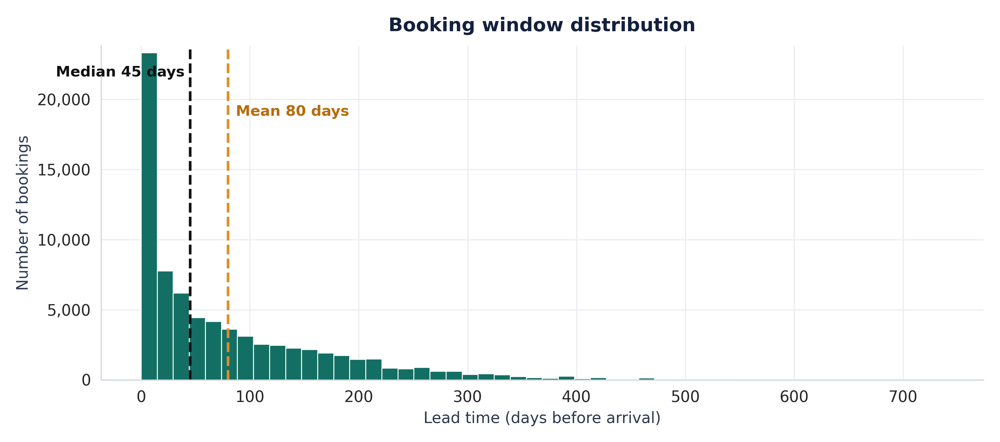

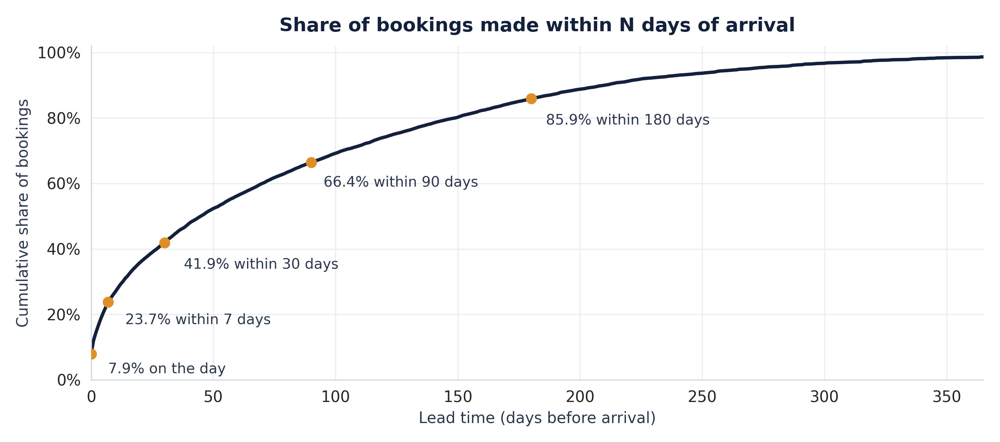

---

## 2. Pace Curve of the Busiest Arrival Date (05 Dec 2015)

The single busiest arrival date in the dataset (**05 Dec 2015**, 255 stayed bookings) did not build smoothly. Instead, its pace curve rose in three discrete jumps driven by contracted Groups blocks: 29 bookings at 135 days out, 29 bookings at 47 days out, and 42 bookings at 11 days out. Only 21.6% of its final volume was on the books 60 days prior, versus 44.1% across the full dataset.

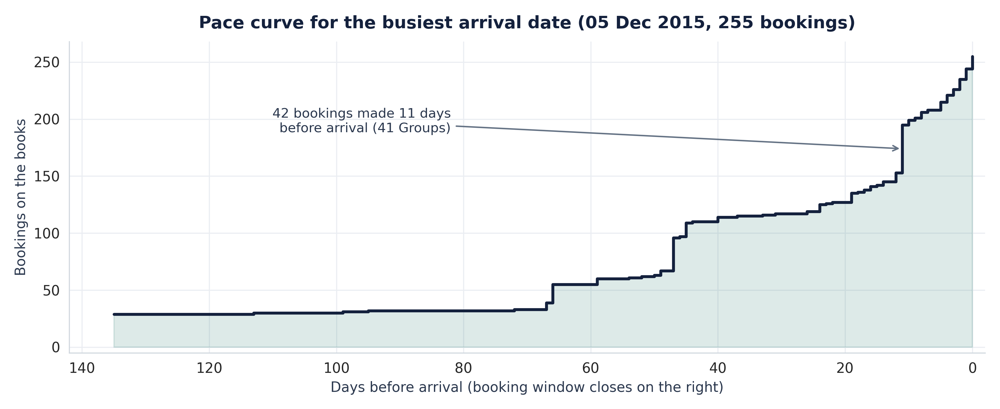

---

## 3. Short-Term Pickup Heatmap (August 2017 Arrivals)

Tracking the 3,109 stayed arrivals in August 2017 (City: 2,002; Resort: 1,107) reveals intense late pickup: **11.2%** of bookings occurred within 3 days of arrival and **15.0%** within 7 days. Four of the five highest-density pickup cells (11 to 14 bookings in a single day) occurred within 2 days of check-in.

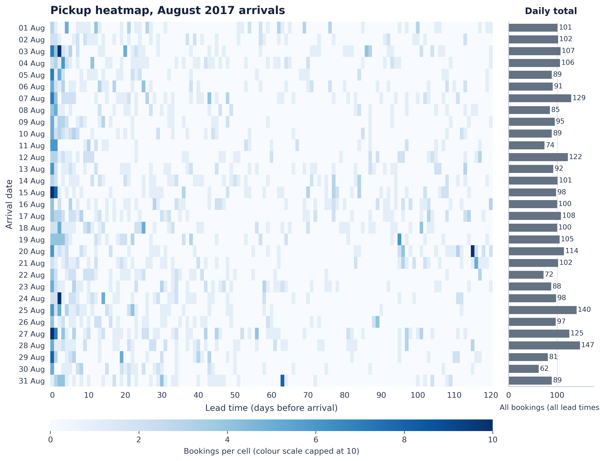

---

## 4. Property and Day-of-Week Booking Clocks

### City Hotel vs. Resort Hotel
City Hotel accounts for 61.5% of stayed bookings (46,228 vs. 28,938) and achieves a higher average rate (**EUR 105.7** vs. **EUR 90.8**). On a relative share basis, Resort Hotel experiences much heavier last-minute pickup, with **28.9%** of bookings arriving within 7 days compared to **20.5%** at City Hotel.

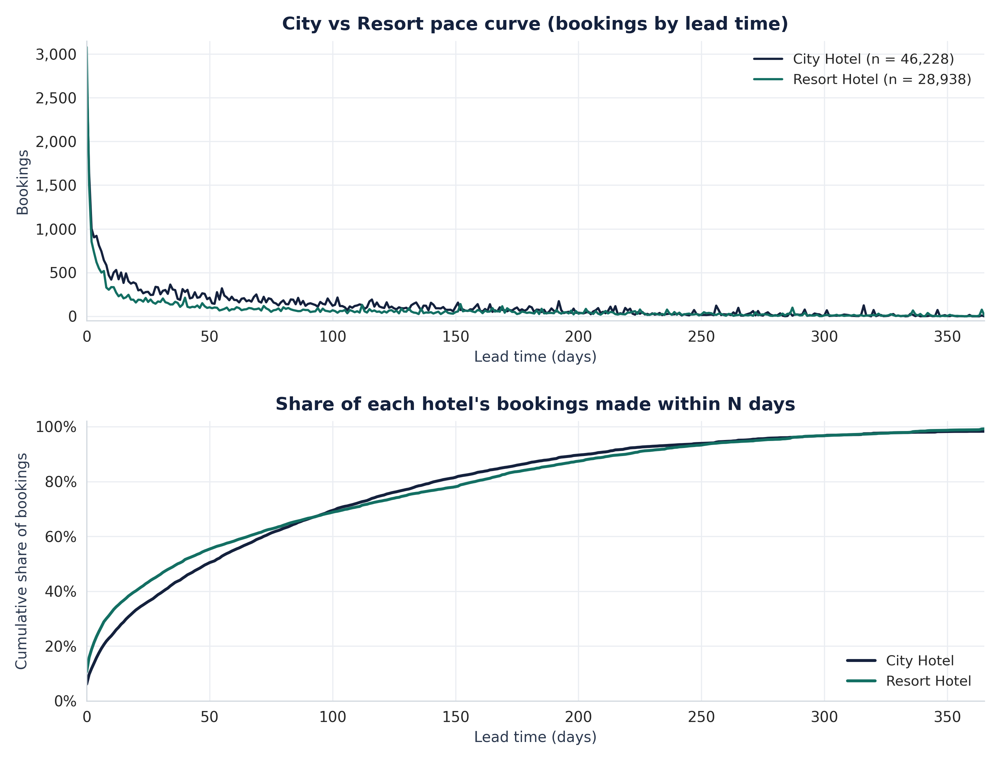

### Weekend vs. Weekday Arrivals
Leisure-oriented weekend arrivals (Friday to Sunday, 32,156 bookings) book roughly **10 days earlier** than weekday arrivals (Monday to Thursday, 43,010 bookings), with a median lead time of **51 days** versus **41 days**. Only 5.8% of weekend arrivals are booked same-day, compared to 9.4% for weekday stays.

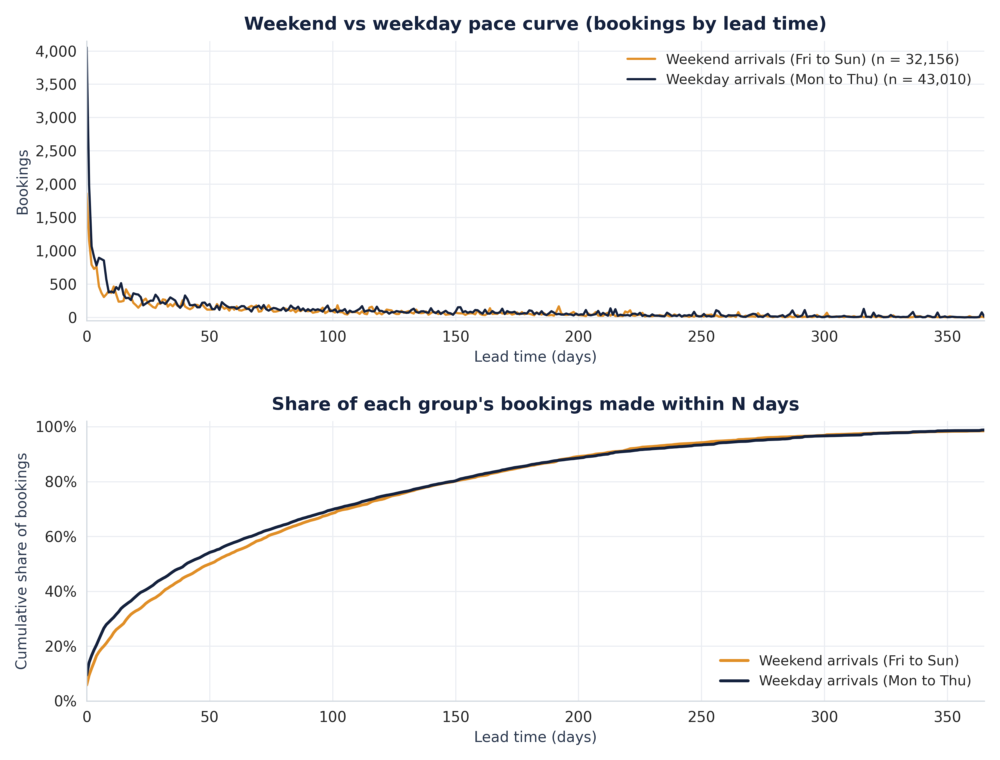

---

## 5. Market Segment Pickup Profiles

Blending all channels into a single hotel-wide pace curve masks stark behavioral differences across segments. Corporate and Direct travelers book close to arrival (58.2% and 45.3% within 7 days), Online TA provides both high volume (47.5% share) and a wide lead-time spread, and Offline TA/TO and Groups anchor long-range base demand.

| Market Segment | Stayed Bookings | Share | Median Lead Time | Same-Day | Within 7 Days | Over 180 Days | Avg ADR (EUR) |
| :--- | :---: | :---: | :---: | :---: | :---: | :---: | :---: |
| **Online TA** | 35,738 | 47.5% | 43 days | 5.5% | 21.1% | 9.7% | 113.9 |
| **Offline TA/TO** | 15,908 | 21.2% | 90 days | 2.6% | 11.2% | 24.4% | 83.4 |
| **Direct** | 10,672 | 14.2% | 11 days | 24.2% | 45.3% | 5.9% | 113.9 |
| **Groups** | 7,714 | 10.3% | 107 days | 0.8% | 7.3% | 33.6% | 77.1 |
| **Corporate** | 4,303 | 5.7% | 6 days | 15.6% | 58.2% | 0.6% | 67.1 |
| **Complementary** | 646 | 0.9% | 3 days | 28.8% | 70.0% | 0.6% | 3.1 |
| **Aviation** | 185 | 0.2% | 3 days | 17.8% | 82.2% | 0.0% | 99.5 |

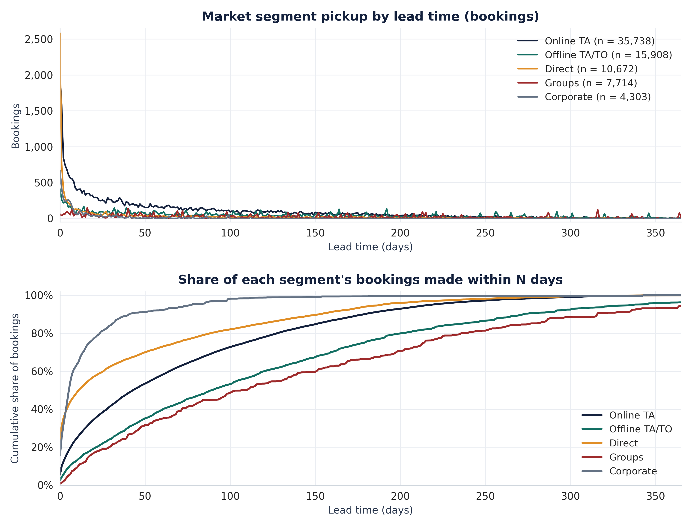

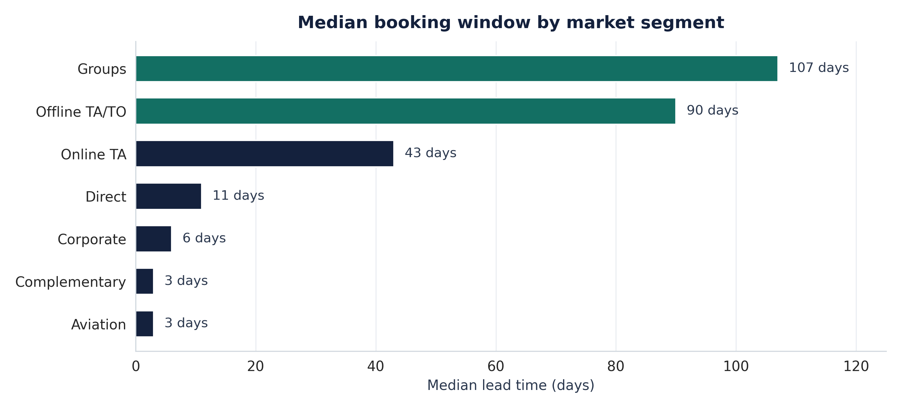

---

## 6. Revenue Pace and ADR Sensitivity by Lead Time

Because average daily rates remain relatively stable across intermediate booking windows (EUR 104.0 to 106.2 between 8 and 180 days out), the cumulative ADR-weighted revenue pace curve closely mirrors booking volume. However, same-day bookings suffer a steep rate drop to **EUR 82.8** (EUR 95 at City; EUR 72 at Resort), while Resort bookings placed more than a year ahead also clear at lower contracted rates (EUR 62).

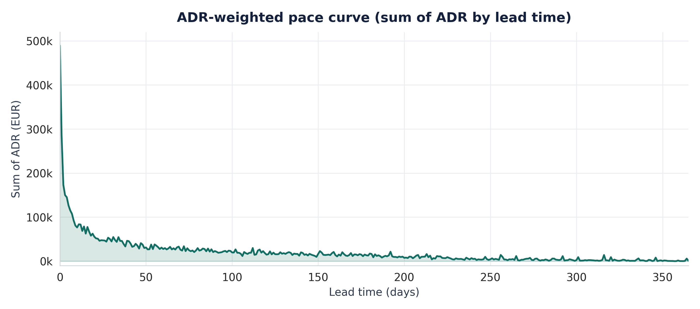

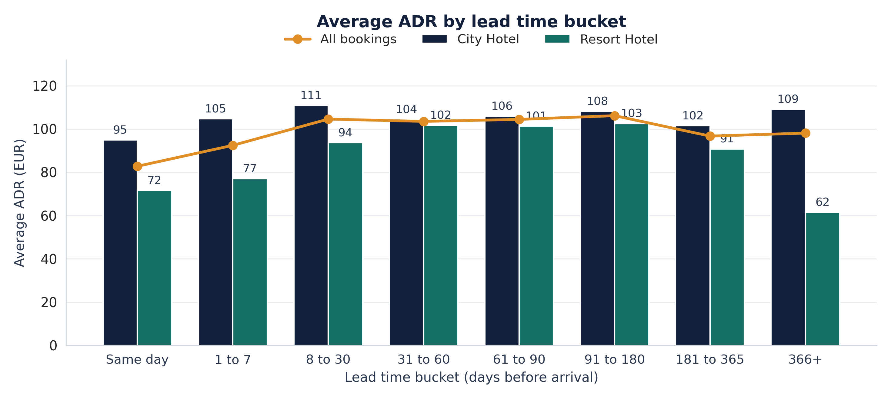

---

## 7. Anatomy of the Top 10 Busiest Arrival Dates

Every single one of the ten highest-volume arrival dates (181 to 255 stayed bookings) was shaped by a single contracted **Groups** (6 dates) or **Offline TA/TO** (4 dates) block ranging from 26 to 122 bookings. Together, those ten single-day blocks accounted for **683 of the 2,203 bookings** (31%) on peak dates, demonstrating why group and travel-trade blocks must be tracked separately from transient pickup curves.

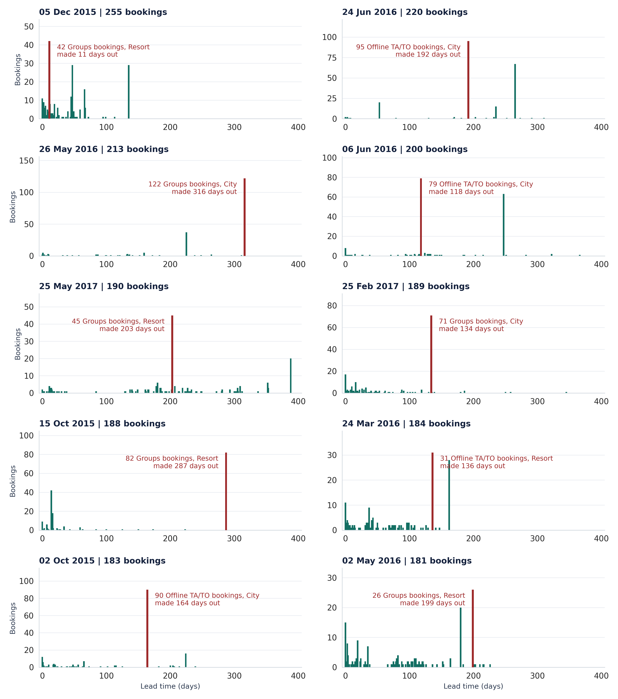

---

## Repository Structure

```text
├── hotel_bookings.csv                          # Source dataset (119,390 total rows; 75,166 stayed bookings)
├── _Hotel_pick up and pace Analysis.ipynb      # Main Python notebook for data prep, pace curves, and visuals
├── Hotel_Pickup_Pace_Report final.pdf          # Executive analytical report (13 pages)
├── Hotel_Pace_and_Pickup_Learning_Guide.pdf    # Concept and methodology learning guide
├── Hotel_Pickup_Pace_Workflow.pdf              # End-to-end analytical workflow documentation
└── images/                                     # High-resolution PNG figures (figure1 to figure11)
